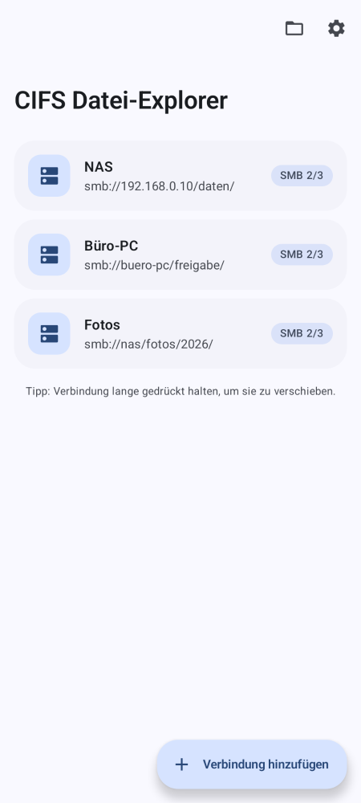
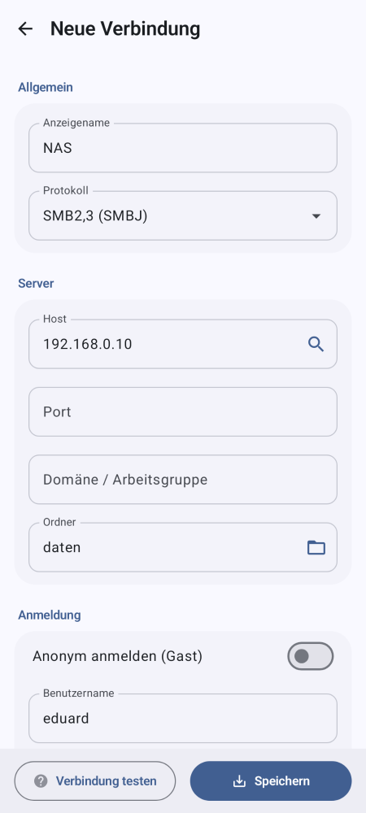
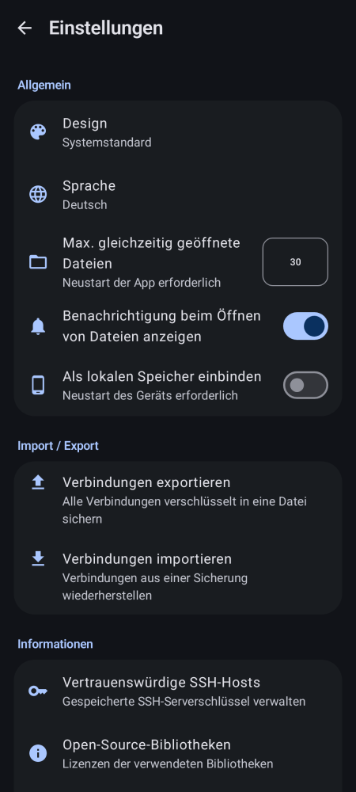
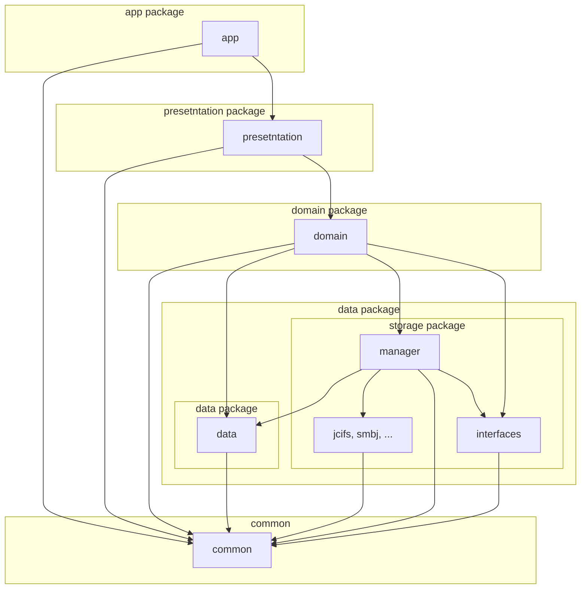

CIFS Datei-Explorer
===================

**SMB-Netzwerkfreigaben direkt in der Android-Dateien-App.** NAS, Windows-PC oder Samba-Server
erscheinen als eigener Speicherort in „Dateien“ und in jedem Dateiauswahl-Dialog – ohne extra Dateimanager.

<div style="display: flex">



</div>

Fork von [CIFS Documents Provider](https://github.com/wa2c/cifs-documents-provider) (wa2c, MIT-Lizenz) mit
komplett überarbeiteter Material-3-Oberfläche und deutscher Übersetzung. Eigene App-ID (`de.cifsdateiexplorer`),
läuft daher parallel zum Original.

## Installation über F-Droid

CIFS Datei-Explorer hat ein eigenes F-Droid-Repo, das bei jedem Release automatisch aktualisiert wird.

1. In der F-Droid-App: **Einstellungen → Paketquellen → +**
2. Adresse: `https://raw.githubusercontent.com/quompacc/cifs-datei-explorer/fdroid/repo`
3. Fingerprint: `A3D02F8518A55C7ABB6EFD41A940211B482E971E6CAF7B3D2DAA8BE85A3CF19F`

Oder auf dem Handy direkt öffnen:
[Repo hinzufügen](fdroidrepos://raw.githubusercontent.com/quompacc/cifs-datei-explorer/fdroid/repo?fingerprint=A3D02F8518A55C7ABB6EFD41A940211B482E971E6CAF7B3D2DAA8BE85A3CF19F)

Alternativ: APK aus den [Releases](https://github.com/quompacc/cifs-datei-explorer/releases) oder über
[Obtainium](https://github.com/ImranR98/Obtainium) mit der GitHub-URL des Repos.

## Release erstellen

1. In `build.gradle.kts` `appVersionName` und `appVersionCode` erhöhen.
2. Changelog anlegen: `fastlane/metadata/android/de-DE/changelogs/<versionCode>.txt` (und `en-US`).
3. Committen, Tag setzen und pushen:
   ```bash
   git tag v1.0.0
   git push origin main --tags
   ```
4. GitHub Actions baut die signierte APK, legt das Release an und aktualisiert das F-Droid-Repo (Branch `fdroid`).

Signiert wird mit dem Release-Keystore aus den Repository-Secrets `KEYSTORE_B64`, `KEYSTORE_PASSWORD`,
`KEY_ALIAS` und `KEY_PASSWORD`. Lokal liest der Build dieselben Werte aus `local.properties`;
ohne Keystore entsteht eine unsignierte Release-APK.

## Entwicklung

* Debug-APK: `./gradlew assembleDebug`
* Screenshots der Oberfläche ohne Gerät rendern (Paparazzi): `./gradlew :presentation:recordPaparazziDebug`
  → `presentation/src/test/snapshots/images/`

## Module Structure



## Guide

* [Wiki](https://github.com/wa2c/cifs-documents-provider/wiki)

## Translation

If you need a translation into your language, please add the translation data on the next page.

* [CIFS Documents Provider Translation Sheet](https://docs.google.com/spreadsheets/d/1y71DyM31liwjcAUuPIk3CuIqxJD2l9Y2Q-YZ0I0XE_E/edit?gid=0#gid=0)

## Licence

Copyright &copy; 2020 wa2c [MIT License](https://github.com/wa2c/cifs-documents-provider/blob/main/LICENSE)

## Author

[wa2c](https://github.com/wa2c)
